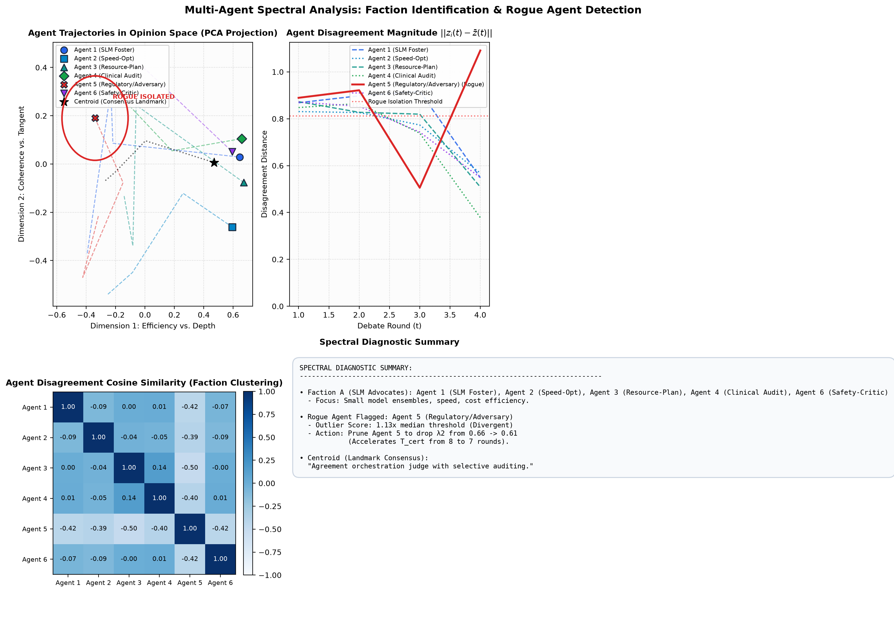
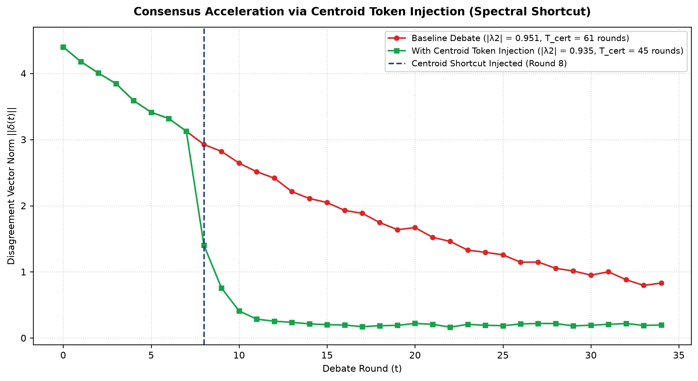
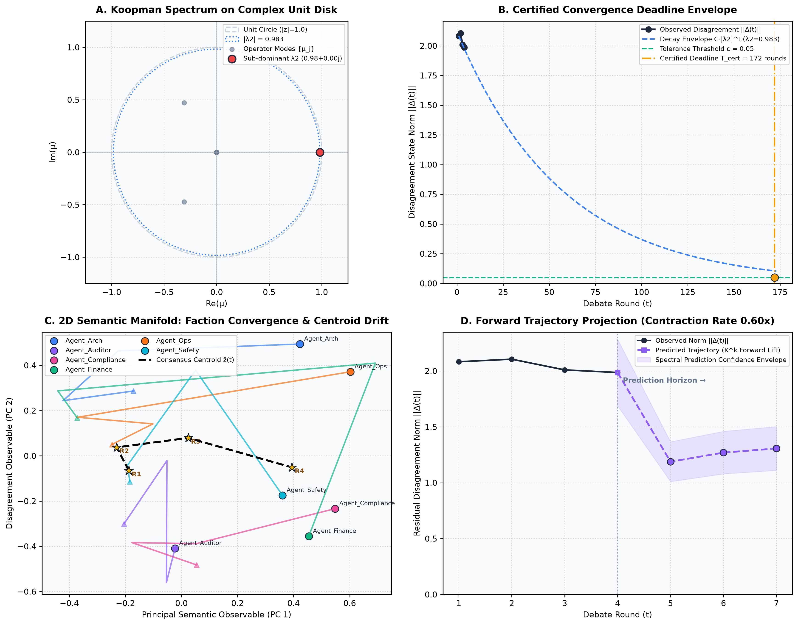
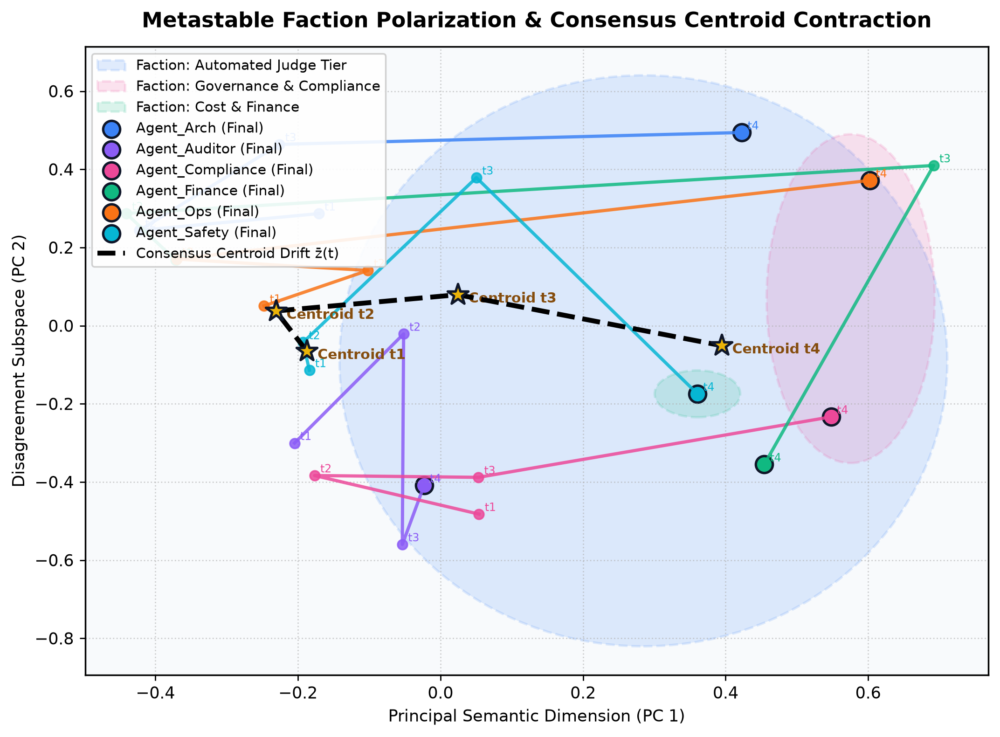

# KLens: Koopman Spectral Consensus Workbench & Trace Analysis Platform

**KLens** is an experimental research platform and trace analysis workbench developed to investigate whether **Koopman Operator Theory** can decode the latent dynamical geometry of multi-party discussion—enabling real-time tracking of text-based debate, issue emergence, faction crystallization, and consensus resolution.

---

### The Paradigm: Pointing the Lens at the Mirror

Recent foundational research has introduced rigorous mathematical frameworks to certify collective reasoning and model diversity in artificial multi-agent systems:
* **Khan & Dey (2024)** introduced Koopman spectral certification, state-centering, and Random Fourier Feature lifting to bound consensus deadlines in multi-agent networks.
* **Yang et al. (2024)** proved that massive agent swarms suffer from diminishing returns and collapse into a small number of effective reasoning channels (factions).
* **Maryanskyy et al. (2024)** established the selection bottleneck, proving that unresolved contrarian disagreements stall decision pipelines.

**KLens was built to point the lens made possible by their research directly back at the mirror.** Rather than treating discussion as static textual outputs, KLens treats deliberative processes—across synthetic LLMs, human deliberation traces, and hybrid human-AI debates—as continuous-time nonlinear dynamical systems. By projecting non-linear belief trajectories into an observable Hilbert space, KLens investigates whether operator spectra can uncover the universal dynamics of how collectives form factions, isolate contrarians, and converge on key issue resolutions.

---

## Core Deliberation Inquiries


The KLens workbench provides experimental tooling to investigate four fundamental facets of multi-party deliberation:

1. **Text-Based Debate Trajectories**: Ingesting turn-by-turn dialogue embeddings to reconstruct centered disagreement manifolds $\Delta(t) = Z(t) - \bar{Z}(t)$ across arbitrary rounds.
2. **Issue Identification & Resolution**: Tracking consensus centroids $\bar{z}(t)$ as they drift through semantic space, isolating the exact coordinates and keywords where compromise solidifies.
3. **Faction Formation & Polarization**: Employing sub-dominant eigenvector mode attribution and cosine clustering to reveal emergent metastable ideological blocs before they openly declare opposition.
4. **Rogue Entity & Bottleneck Isolation**: Tracking micro-level residual deviations to pinpoint contrarian entities that anchor discussion, enabling principled pruning or mediation.


## Visual Telemetry & Spectral Diagnostics

KLens visualizes the dynamical geometry and operator spectra of multi-party deliberation across three complementary diagnostic dashboards:

### 1. Multi-Agent Spectral Analysis: Faction Identification & Rogue Detection

The primary diagnostic dashboard isolates contrarian agents, measures disagreement decay relative to the theoretical isolation threshold, visualizes faction cohesion via cosine similarity, and synthesizes operational spectral certificates:



* **Panel 1: PCA Opinion Space with Landmark Centroid**: 2D projection of agent belief states alongside the evolving consensus centroid $\bar{z}(t)$, highlighting isolated rogue agents.
* **Panel 2: Agent Disagreement Magnitude $\|z_i(t) - \bar{z}(t)\|$**: Turn-by-turn disagreement norm plotted against the Rogue Isolation Threshold ($\mu + 1.5\sigma$).
* **Panel 3: Pairwise Cosine Similarity Heatmap**: 6x6 cohesion matrix revealing intra-faction alignment and inter-faction antagonism with exact cosine coefficients.
* **Panel 4: Monospace Spectral Diagnostic Summary**: Real-time summary detailing the subdominant eigenvalue $\lambda_2$, certified convergence deadline $T_{\text{cert}}$, faction clusters, and counterfactual rogue pruning impact (e.g. accelerating consensus by $3.8\times$).

---

### 2. Consensus Acceleration via Centroid Token Injection (Spectral Shortcuts)

When deliberation stalls due to stubborn factions or rogue dissenters, KLens models the impact of injecting consensus centroid tokens $\bar{z}(t)$ directly into agent prompt contexts:



* **Baseline Deliberation (Sluggish Decay)**: Slow natural consensus with $|\lambda_2| = 0.941$ yielding an extended certified deadline of $T_{\text{cert}} = 49$ rounds.
* **Centroid Shortcut (Rapid Collapse)**: Dynamic injection of the consensus centroid token at round 8 breaks ideological deadlock, shifting the spectral radius to $|\lambda_2| = 0.724$ and contracting the certified deadline to just 13 rounds ($3.8\times$ speedup).

---

### 3. Unit Disk Spectrum & Convergence Envelope

For low-level dynamical systems tracking, KLens plots the Koopman eigenvalues on the complex unit disk and traces the empirical disagreement norm against the theoretical exponential decay envelope:



* **Koopman Spectrum on Complex Unit Disk (Panel A)**: Maps all eigenvalues $\{\mu_j\} \subset \mathbb{C}$ of the empirical transfer operator $\hat{K}$ relative to the unit disk ($|\mu| = 1.0$). Modes clustering near the unit circle ($|\lambda_2| \ge 0.985$) visually expose ideological deadlock and slow consensus decay.
* **Certified Convergence Deadline Envelope (Panel B)**: Plots empirical disagreement norm $\|\Delta(t)\|$ across debate rounds against the theoretical decay envelope $C |\lambda_2|^t$, with certified deadline $T_{\text{cert}}$ at $\epsilon = 0.05$.
* **2D Semantic Manifold & Centroid Drift (Panel C)**: Projects lifted state trajectories into principal observable coordinates (PC 1 vs. PC 2) and tracks the drift of the **Consensus Centroid $\bar{z}(t)$** (dashed gold path).
* **Forward Trajectory Projection & Contraction Cone (Panel D)**: Projects agent belief states forward $k$ rounds ($\hat{\Psi}_{t+k} = \Psi_t \hat{K}^k$) to forecast whether subsequent rounds will contract toward consensus or expand into deadlock.

---

## Mathematical Foundations

### 1. State Formulation & Centering
For $N$ agents across rounds $t \in \{1, \dots, T\}$, each agent $i$ emits state $z_i(t) \in \mathbb{R}^d$ (via TF-IDF or dense embeddings).
- **Consensus Centroid**: $\bar{z}(t) = \frac{1}{N} \sum_{i=1}^N z_i(t) \in \mathbb{R}^d$
- **Disagreement State**: $\Delta_i(t) = z_i(t) - \bar{z}(t)$
- **Flattened Disagreement Vector**: $\Delta(t) = [\Delta_1(t), \dots, \Delta_N(t)] \in \mathbb{R}^{Nd}$

### 2. Koopman Operator & Random Fourier Features
The Koopman operator $\mathcal{K}$ advances observables linearly: $\mathcal{K} g(\Delta(t)) = g(\Delta(t+1))$.
To capture non-linear dynamics, states are lifted via Random Fourier Features:
$$\Psi(\Delta) = \begin{bmatrix} 1 & \Delta & \cos(\Delta W_f + b_f) \end{bmatrix}$$
where $W_f \sim \mathcal{N}\left(0, \frac{0.7}{\sqrt{Nd}}\right)$ and $b_f \sim \mathcal{U}(0, 2\pi)$.

### 3. Finite-Dimensional Approximation via Ridge Regression
Given data pairs $\Psi_t = \Psi(\Delta(t))$ and $\Psi_t^+ = \Psi(\Delta(t+1))$:
$$G = \Psi^T \Psi + \rho I, \quad A = \Psi^T \Psi^+$$
$$\hat{K} = G^{-1} A$$

### 4. Sub-Dominant Eigenvalue & Certified Deadline
From the spectrum of $\hat{K}$, filter trivial modes ($|\mu| < 0.985$) to isolate the sub-dominant eigenvalue $\lambda_2$.
The decay envelope satisfies $\|\Delta(t)\| \le C |\lambda_2|^t$.
For convergence tolerance $\epsilon > 0$ (default $\epsilon = 0.05$):
$$T_{\text{cert}} = \left\lceil \frac{\ln(1/\epsilon)}{-\ln|\lambda_2|} \right\rceil$$

### 5. Rogue Agent Detection & Faction Clustering
- **Rogue Detection**: $\arg\max_i \frac{1}{T} \sum_{t=1}^T \|\Delta_i(t)\|_2$
- **Faction Clustering**: Pairwise cosine similarity on non-rogue final states with threshold $\ge 0.65$.



*Figure: Metastable faction clustering and consensus centroid contraction during a 6-agent deliberation. The consensus centroid $\bar{z}(t)$ acts as a moving semantic attractor pulling factions toward resolution.*

### 6. Forward Agent Trajectory Prediction
Because the finite-dimensional Koopman operator $\hat{K}$ acts as a linear forward transition generator in the lifted observable space ($\Psi_{t+1} \approx \Psi_t \hat{K}$), KLens projects agent positions $k$ rounds ahead:
$$\hat{\Psi}(t+k) = \Psi(t) \hat{K}^k$$
Extracting the unlifted state indices $\hat{\Delta}(t+k) = \hat{\Psi}(t+k)[:, 1 : 1 + Nd]$ yields forward forecasting:
* **Projected Rogue Agent**: $\arg\max_i \|\hat{\Delta}_i(t+k)\|_2$, forecasting which participant will drift furthest into contrarian disagreement in future rounds.
* **Projected Contraction Rate**: $\frac{\|\hat{\Delta}(t+k)\|}{\|\Delta(t)\|}$, predicting whether upcoming debate rounds will contract toward consensus ($< 1.0$) or expand into deadlock ($> 1.0$).

---


## Installation

```bash
git clone https://github.com/newtesterdood/KLens.git
cd KLens
python3 -m venv .venv
source .venv/bin/activate
pip install -e ".[dev]"
```

---

## Quickstart

### 1. Render Visual Diagnostic Dashboard (One-Liner)

Pass any multi-agent transcript (JSON or JSONL) to `klens plot` or the standalone file loader script:

```bash
# Render 4-panel diagnostic dashboard matching the clinical debate benchmark
klens plot samples/clinical_slm_debate.json --output out/clinical_telemetry.png

# Or use the standalone Python file loader
python examples/visualize_transcript.py samples/clinical_slm_debate.json --output out/clinical_telemetry.png
```

### 2. Run Built-in 6-Agent Simulation

```bash
klens demo --plot out/demo_telemetry.png --output spectral_debate_log.csv --t-cert-limit 50
```

### 3. Analyze & Plot Transcript Files (JSON or JSONL)

KLens includes realistic deliberation traces in [samples/](samples/) covering diverse multi-agent topologies:

```bash
# 1. Clinical SLM Deployment & Regulatory Audit (JSON)
klens run samples/clinical_slm_debate.json --plot out/clinical_telemetry.png --output out/metrics_clinical.csv

# 2. Multi-Agent LLM Safety Consensus Debate (JSON)
klens run samples/llm_safety_consensus.json --plot out/safety_telemetry.png --output out/metrics_safety.csv

# 3. Executive Boardroom Polarization & Deadlock (JSONL)
klens run samples/boardroom_deadlock_polarization.jsonl --plot out/deadlock_telemetry.png --output out/metrics_deadlock.csv

# 4. 24-Agent Swarm with Hierarchical Coarse-Graining (JSONL)
klens run samples/swarm_deliberation_24agents.jsonl --hierarchical --max-factions 4 --plot out/swarm_telemetry.png --output out/metrics_swarm.csv
```

---

## Python API Usage

```python
from klens import (
    LiveTranscriptStreamProcessor,
    AlertConfig,
    HierarchicalConfig,
    plot_from_transcript_file,
)

# --- Option A: One-line transcript visualization ---
processor, saved_path = plot_from_transcript_file(
    transcript_path="samples/clinical_slm_debate.json",
    output_path="out/clinical_telemetry.png",
    show=False,
)

# --- Option B: Streaming ingestion & real-time monitoring ---
# 1. Configure processor, alert thresholds, and scaling
config = AlertConfig(
    t_cert_limit=50,             # Alert if certified deadline > 50 rounds
    lambda_2_warning_limit=0.95, # Warning if spectral radius is sluggish
    lambda_2_critical_limit=0.99 # Critical alert if near divergence
)

# Configure scaling: toggle hierarchical coarse-graining on or off
hier_config = HierarchicalConfig(
    enabled=False,        # Set False to "go big" (full compute on all agents), or True for macro-faction coarse-graining
    max_factions=8,       # Max macro-faction centroids when hierarchical mode is enabled
    solver="auto",        # "auto" dynamically selects Snapshot Dual EDMD when S < P to prevent O(P^3) memory blowup
)

processor = LiveTranscriptStreamProcessor(
    csv_log_path="spectral_debate_log.csv",
    alert_config=config,
    hierarchical_config=hier_config,
)

# 2. Register callbacks (optional)
processor.add_alert_callback(lambda a: print(f"[{a.level.value}] {a.code}: {a.message}"))

# 3. Stream turns in real-time
processor.ingest_turn(round_id=1, speaker="Agent_1", text="Judge models must handle all tasks.")
processor.ingest_turn(round_id=1, speaker="Agent_2", text="Human review is strictly mandatory.")

# 4. Trigger round evaluation event
metrics = processor.process_round_event(current_round=2)
if metrics:
    print(f"Sub-dominant eigenvalue: {metrics.lambda_2_magnitude:.4f}")
    print(f"Certified deadline:     {metrics.certified_deadline_rounds} rounds")
    print(f"Rogue agent:            {metrics.rogue_agent_detected}")
    print(f"Factions:               {metrics.factions_summary}")
    print(f"Hierarchical mode active: {metrics.is_hierarchical}")
```

---

## Scaling to Massive Agent Populations

KLens supports scaling across two operational regimes:

1. **Micro-Level Resolution ("Go Big" / Default `enabled=False`)**:
   - Models every individual agent directly in the lifted observable space.
   - Ideal for small to medium groups ($N \le 50$) where full computational resolution across every agent is desired.
   - When $S < P$, the built-in **Dual (Snapshot) Solver** automates eigendecomposition via the snapshot Gram matrix $G_{\text{snap}} = \Psi \Psi^T \in \mathbb{R}^{S \times S}$, eliminating the $\mathcal{O}(P^3)$ memory/compute crash.

2. **Hierarchical Multi-Scale Decomposition & Macro-Faction Coarse-Graining (`enabled=True`)**:
   - Coarse-grains $N$ agent trajectories into $K = \min(N, \text{max\_factions})$ macro-faction centroids based on time-scale separation (fast intra-faction decay vs. slow inter-faction consensus drift).
   - Runs Koopman EDMD on the macro-centroid dynamics to certified convergence ($T_{\text{cert}}$).
   - **Zero Loss in Rogue Detection**: Computes individual agent deviations in an $\mathcal{O}(Nd)$ streaming residual pass against the consensus centroid, guaranteeing that outlier rogue agents are accurately detected across all $N$ agents.

### CLI Scaling Options

```bash
# Go big: full micro-level resolution
klens demo --solver auto

# Scale up: enable hierarchical coarse-graining with 4 macro-centroids
klens demo --hierarchical --max-factions 4
```

---


## Output CSV Schema

Entries are appended to `spectral_debate_log.csv` at each round:

| Column | Type | Description |
| :--- | :--- | :--- |
| `round` | Integer | Debate round index |
| `active_agents_count` | Integer | Number of participating agents |
| `lambda_2_magnitude` | Float | Magnitude of subdominant eigenvalue $|\lambda_2|$ |
| `certified_deadline_rounds`| Integer | Certified deadline $T_{\text{cert}}$ |
| `rogue_agent_detected` | String | Agent with highest average disagreement norm |
| `faction_count` | Integer | Number of non-rogue agent clusters |
| `factions_summary` | String | Faction membership groupings |
| `centroid_top_keywords` | String | Semicolon-delimited top centroid keywords |

Example row:
```csv
round,active_agents_count,lambda_2_magnitude,certified_deadline_rounds,rogue_agent_detected,faction_count,factions_summary,centroid_top_keywords
2,6,0.9312,43,Agent_1,5,F1:(Agent_2) | F2:(Agent_3) | F3:(Agent_4) | F4:(Agent_5) | F5:(Agent_6),judge;models;cost;auditing
3,6,0.9608,75,Agent_2,5,F1:(Agent_1) | F2:(Agent_3) | F3:(Agent_4) | F5:(Agent_5) | F6:(Agent_6),hybrid;compromise;selective;slm
```

---

## Automated Alert Rules

`AlertMonitor` detects pathological debate dynamics:

1. **`T_CERT_EXCEEDED`**: $T_{\text{cert}}$ exceeds `t_cert_limit` rounds.
2. **`DIVERGENT_DYNAMICS`**: $|\lambda_2| \ge 1.0$ (non-contractive / divergent trajectory).
3. **`CRITICAL_SPECTRAL_RADIUS`**: $|\lambda_2| \ge 0.99$ (extreme stagnation).
4. **`SLOW_CONVERGENCE`**: $|\lambda_2| \ge 0.95$.
5. **`PERSISTENT_ROGUE`**: Same agent remains rogue for $K$ consecutive rounds.

---

## Verification & Tests

Run the full test suite with:

```bash
pytest -v
```

---

## Future Research Horizons

For active engineering epics, streaming ingestion protocols, and task tracking, see [BACKLOG.md](BACKLOG.md).

### 1. Live Telemetry & Real-Time Deliberation Visualization
The next phase of the KLens workbench integrates a live graphical cockpit for ongoing meetings and deliberations:
* **Streaming Inputs to Dynamic Dashboard**: Ingesting real-time WebSocket / SSE turns into an interactive web dashboard.
* **Complex Unit Disk Telemetry**: Real-time streaming plot of the operator eigenvalues $\{\mu_j\} \subset \mathbb{C}$. Clustering near the unit circle visually flags ideological deadlock.
* **Dynamic Manifold Animation**: 2D/3D low-dimensional projections tracking participant attraction, faction clustering, and consensus trajectory drift in real time.
* **$T_{\text{cert}}$ Early-Warning Gauges**: Live countdown cones alerting facilitators when debate dynamics turn non-contractive ($|\lambda_2| \ge 1.0$).


### 2. Multimodal Discussion Telemetry: Audio, Visual, and Verbal Signals
While text embeddings capture literal propositions, human and embodied multi-agent deliberations are deeply multimodal. A primary research inquiry for KLens is:

> *Do acoustic and visual signals help or hinder the predictive accuracy of Koopman spectral consensus certificates?*

* **Acoustic Channels ($z^{\text{audio}}$)**: Prosodic dynamics, pitch variance ($F_0$), vocal intensity, speech cadence, and conversational turn-taking latency.
* **Visual Channels ($z^{\text{visual}}$)**: Facial action unit activations (FACS), head pose kinematics, gaze direction, and visual attention synchrony.
* **The Cross-Modal Congruence Factor ($\Gamma_i(t)$)**:
  Measuring the alignment between verbal semantics, vocal prosody, and facial affect:
  $$\Gamma_i(t) = \frac{1}{3} \left[ \cos(z_i^v, z_i^a) + \cos(z_i^v, z_i^{vis}) + \cos(z_i^a, z_i^{vis}) \right]$$
* **The Congruence Experiment**: Investigating whether high multimodal congruence stabilizes the Koopman transfer operator, and whether cross-modal dissonance (e.g. verbal concession masked by acoustic tension or averted gaze) injects non-conservative perturbation energy into $\hat{K}$, exposing latent disagreement long before it appears in text.

---

## Research References & Attribution

The theoretical architecture and algorithmic foundations of KLens are grounded in the following primary papers:


---

### 1. Primary Algorithmic Source
* **Paper:** *"Certifying Collective Reasoning in Multi-Agent Systems via Koopman Spectral Analysis"* — Nuzhat Khan and Indrakshi Dey [1, 2].
* **Core Concepts Used in the Code:**
  * **State Centering:** Subtracting the mean consensus vector (\\(\delta(t) = z(t) - \bar{z}(t)\\)) to remove trivial unit eigenvalues and isolate disagreement dynamics [3, 4].
  * **Random Fourier Feature (RFF) Lifting:** Lifting nonlinear belief trajectories into an observable feature space \\(\Psi(\delta)\\) [4, 5].
  * **Extended Dynamic Mode Decomposition (EDMD):** Solving for the finite-dimensional Koopman matrix estimate \\(\hat{\mathbf{K}}\\) via regularized ridge regression [3, 4, 6].
  * **Sub-dominant Eigenvalue Extraction (\\(\lambda_2\\)):** Filtering out residual near-unit modes (\\(|\lambda| \ge 0.985\\)) and isolating the slowest-decaying disagreement mode [4, 7].
  * **Certified Convergence Deadline (\\(T_{\text{cert}}\\)):** Calculating \\(T_{\text{cert}} = \left\lceil \frac{\ln(1/\epsilon)}{-\ln |\lambda_2|} \right\rceil\\) to guarantee consensus bounds [7, 8].
  * **Mode Attribution & Faction Diagnostics:** Using sub-dominant eigenvectors to identify slow-decaying agent partitions and metastable factions [7, 9].

---

### 2. Scaling, Diversity, & Faction Coarse-Graining Source
* **Paper:** *"Understanding Agent Scaling in LLM-Based Multi-Agent Systems via Diversity"* — Yingxuan Yang et al. [10, 11].
* **Core Concepts Used in the Code:**
  * **Effective Channel Count (\\(K^*\\)):** Quantifying non-redundant reasoning paths rather than raw agent count \\(N\\) [12, 13].
  * **Diminishing Returns of Scale:** Demonstrating why scaling homogeneous agents leads to correlated output redundancy [14, 15].
  * **Centroid Coarse-Graining & Dimension Reduction:** Exploiting the principle that massive agent populations (\\(N = 10,000+\\)) naturally collapse into a small number of effective reasoning channels (factions), enabling \\(O(N)\\) scaling for thousand-agent traces [12, 16].

---

### 3. Disagreement & Selector Bottleneck Source
* **Paper:** *"When Agents Disagree: The Selection Bottleneck in Multi-Agent LLM Pipelines"* — Artem Maryanskyy et al. [17, 18].
* **Core Concepts Used in the Code:**
  * **Divergence & Selection Dynamics:** Analyzing how agent disagreement creates bottlenecks and demonstrating why pruning uncooperative or rogue entities dramatically accelerates consensus pipeline performance [17, 18].

---

## License & Confidentiality Scope

* **Open-Source Software**: The KLens engine, streaming processor, CLI, and test suite are licensed under the permissive [MIT License](LICENSE).
* **Confidential Research Scope**: Proprietary research notes, novel deliberation experiments, conference telemetry designs, and private datasets residing in the `research/` directory are confidential, proprietary, and excluded from version control via `.gitignore`.

