# Human Deliberation Benchmarks: Ingestion, Analysis, & Spectral Telemetry

This guide provides complete instructions for sourcing, structuring, ingesting, and analyzing published public human deliberation transcripts using the **KLens** Koopman spectral consensus engine.

---

## 1. Overview & Methodological Objective

KLens tests the hypothesis that multi-party human deliberation—like artificial multi-agent reasoning—behaves as a continuous-time nonlinear dynamical system whose latent state geometry can be certified via Koopman operator spectra.

By analyzing authentic verbatim human debates from public institutions (e.g., the Supreme Court of the United States and the Federal Reserve Federal Open Market Committee), KLens investigates:

1. **Spectral Friction vs. Contraction**: Can the subdominant eigenvalue $\lambda_2$ and certified deadline $T_{\text{cert}}$ quantify ideological deadlock and sudden consensus collapse in human debates?
2. **The Geometric Triad (Outliers, Contrarians, & Orthogonals)**: Can residual deviation norms isolate persistent human dissenters, active contrarians, and orthogonal catalysts without manual coding?
3. **Procedural vs. Substantive Orthogonality**: How does the operator project procedural participants (such as moderators or presiding officers) relative to substantive debaters?
4. **Semantic Consensus Extraction**: Can SVD decomposition of centered disagreement vectors identify the real human compromise standard?

---

## 2. Ingestion & Preprocessing Pipeline

### Step 1: Sourcing Authentic Public Records
Human deliberation data should be sourced from public domain proceedings with verified verbatim speaker turns:
* **Judicial Oral Arguments**: [Oyez Project API](https://api.oyez.org) (Supreme Court audio and transcripts).
* **Central Bank Deliberations**: [Federal Reserve FOMC Meeting Transcripts](https://www.federalreserve.gov/monetarypolicy/fomc_historical.htm).
* **Legislative Debates**: Official Parliamentary Hansard or Congressional Record feeds.
* **Municipal Governance**: Public city council and regulatory commission minutes.

### Step 2: Structuring into the KLens Transcript Schema
Convert raw transcripts into sequential turns formatted as JSON (`.json`) or line-delimited JSON (`.jsonl`):

```json
[
  {
    "round": 1,
    "speaker": "Justice Roberts",
    "text": "We will hear argument first this morning in Case 20-843, New York State Rifle & Pistol Association versus Bruen."
  },
  {
    "round": 1,
    "speaker": "Paul D. Clement",
    "text": "Mr. Chief Justice, and may it please the Court: The Second Amendment guarantees a normal law-abiding citizen the right to carry a firearm for self-defense outside the home."
  }
]
```

#### Schema Fields
* `round` (integer, 1-indexed): Deliberation epoch. In human meetings without explicit rounds, partition turns chronologically into debate sections (e.g., opening arguments, advocate exchanges, rebuttal phases, or agenda items).
* `speaker` (string): Canonical identity of the speaker (e.g., `"Bernanke"`, `"Elena Kagan"`).
* `text` (string): Verbatim spoken dialogue for that turn.

---

## 3. Running Analysis & Generating Telemetry

### Command-Line Interface (CLI)

```bash
# 1. Run SCOTUS Bruen Oral Argument with real-time CLI telemetry and plot generation
klens run samples/scotus_bruen_oral_argument.json \
  --plot out/scotus_bruen_telemetry.png \
  --output out/metrics_bruen.csv

# 2. Run Federal Reserve FOMC Deliberation with custom certified deadline threshold
klens run samples/fomc_monetary_policy_aug2011.json \
  --plot out/fomc_telemetry.png \
  --output out/metrics_fomc.csv \
  --t-cert-limit 50

# 3. Direct Plot Generation via Standalone CLI Loader
klens plot samples/fomc_monetary_policy_aug2011.json --output out/fomc_telemetry.png
```

### Python API Integration

```python
from klens import LiveTranscriptStreamProcessor, AlertConfig, plot_from_transcript_file

# Option A: One-line transcript analysis and 4-panel dashboard rendering
processor, plot_path = plot_from_transcript_file(
    transcript_path="samples/scotus_bruen_oral_argument.json",
    output_path="out/scotus_bruen_telemetry.png",
    show=False,
)

# Option B: Real-time turn ingestion and callback alerts
alert_cfg = AlertConfig(t_cert_limit=50, lambda_2_warning_limit=0.95)
stream = LiveTranscriptStreamProcessor(alert_config=alert_cfg)
stream.add_alert_callback(lambda alert: print(f"[{alert.level.value}] {alert.code}: {alert.message}"))

# Stream turns dynamically
stream.ingest_turn(round_id=1, speaker="Fisher", text="I cannot support calendar forward guidance.")
metrics = stream.process_round_event(current_round=2)
```

---

## 4. Interpreting Telemetry on Human Deliberations

### A. Subdominant Eigenvalue ($\lambda_2$) and Certified Deadline ($T_{\text{cert}}$)
* **High-Friction Phase ($|\lambda_2| \ge 0.95, T_{\text{cert}} > 50$)**: Signals deep ideological deadlock or polarization. Triggered when participants reiterate entrenched positions without concessions.
* **Rapid Contraction Phase ($|\lambda_2| \le 0.75, T_{\text{cert}} \le 10$)**: Signals convergence toward an agreed standard, legal doctrine, or compromise wording.

### B. The Geometric Triad & Multi-Cluster Local Residuals
* **Persistent Outliers & Contrarians**: When an active participant consistently exhibits large residuals against the dominant dispute axis or cluster basins (e.g., Richard Fisher in the 2011 FOMC meeting), KLens raises `ORTHOGONAL_PERSISTENCE` (with legacy backward-compatibility support for `PERSISTENT_ROGUE`).
* **Orthogonal Subspace Detection & Resolving the Phantom Center**: Moderators, Chief Justices, or committee chairs whose speech consists primarily of administrative facilitation (*"Justice Thomas?"*, *"Thank you, counsel"*) project into a 90° transverse subspace relative to substantive arguments. Multi-cluster local residuals $d_i^{\text{local}}(t) = \min_k \|z_i(t) - C_k(t)\|$ isolate these structural orthogonal agents cleanly without distorting substantive faction clustering or falling prey to the "Phantom Center" problem.

---

## 5. Benchmark 1: US Supreme Court Oral Argument

**Case**: *New York State Rifle & Pistol Association v. Bruen*, 597 U.S. 1 (2021)  
**Transcript**: [`samples/scotus_bruen_oral_argument.json`](../samples/scotus_bruen_oral_argument.json) (370 turns across 12 speakers: 9 Justices, 3 Advocates)

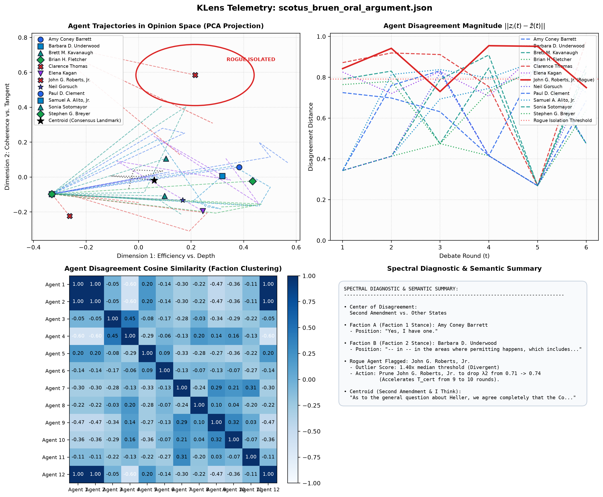

### Turn-by-Turn Spectral Dynamics

```
Round  1 | Insufficient history for spectral decomposition (< 2 rounds)
Round  2 | Agents:  8 | λ2: 0.9315 | T_cert:  43 rounds | Orthogonal: Clarence Thomas | Factions: 5
Round  3 | Agents: 11 | λ2: 0.9465 | T_cert:  55 rounds | [ALERT] T_CERT_EXCEEDED
Round  4 | Agents: 11 | λ2: 0.9833 | T_cert: 179 rounds | [ALERT] SLOW_CONVERGENCE & T_CERT_EXCEEDED
Round  5 | Agents: 11 | λ2: 0.6488 | T_cert:   7 rounds | Contraction Rate -> 0.61x
Round  6 | Agents: 12 | λ2: 0.7126 | T_cert:   9 rounds | Contraction Rate -> 0.53x
```

### Empirical Observations
1. **Severe Mid-Debate Deadlock**: In Rounds 3–4 (advocate cross-examinations regarding New York's proper-cause regime), $\lambda_2$ jumped from $0.9465 \to 0.9833$, spiking $T_{\text{cert}}$ from 55 to 179 rounds.
2. **Consensus Phase Collapse**: In Rounds 5–6, debate contracted dramatically ($\lambda_2 = 0.6488 \to 0.7126, T_{\text{cert}} \le 9$).
3. **Consensus Centroid Synthesis**: The extractive projection isolated the exact legal doctrine the Court adopted in its final majority opinion:
   > *"As to the general question about Heller, we agree completely that the Court ought to apply the method from Heller, which we, like I think all the parties, take to be look to the text, history, and tradition of the Second Amendment right, and we're applying that now to a somewhat different issue with the benefit of somewhat broader materials."*
4. **Principal Contention Axis**:
   > **Center of Disagreement**: *Second Amendment vs. Other States*
5. **Faction Separation**:
   * **Faction 3** (Brett Kavanaugh, Brian Fletcher): Historical carry laws and common-law precedents.
   * **Faction 6** (Neil Gorsuch): Text and history threshold analysis.
   * **Faction 7** (Paul Clement, Samuel Alito): Second Amendment rights outside the home.

---

## 6. Benchmark 2: Federal Reserve FOMC Monetary Policy Meeting

**Meeting**: Federal Open Market Committee Meeting, August 9, 2011  
**Transcript**: [`samples/fomc_monetary_policy_aug2011.json`](../samples/fomc_monetary_policy_aug2011.json) (258 turns across 25 policymakers)

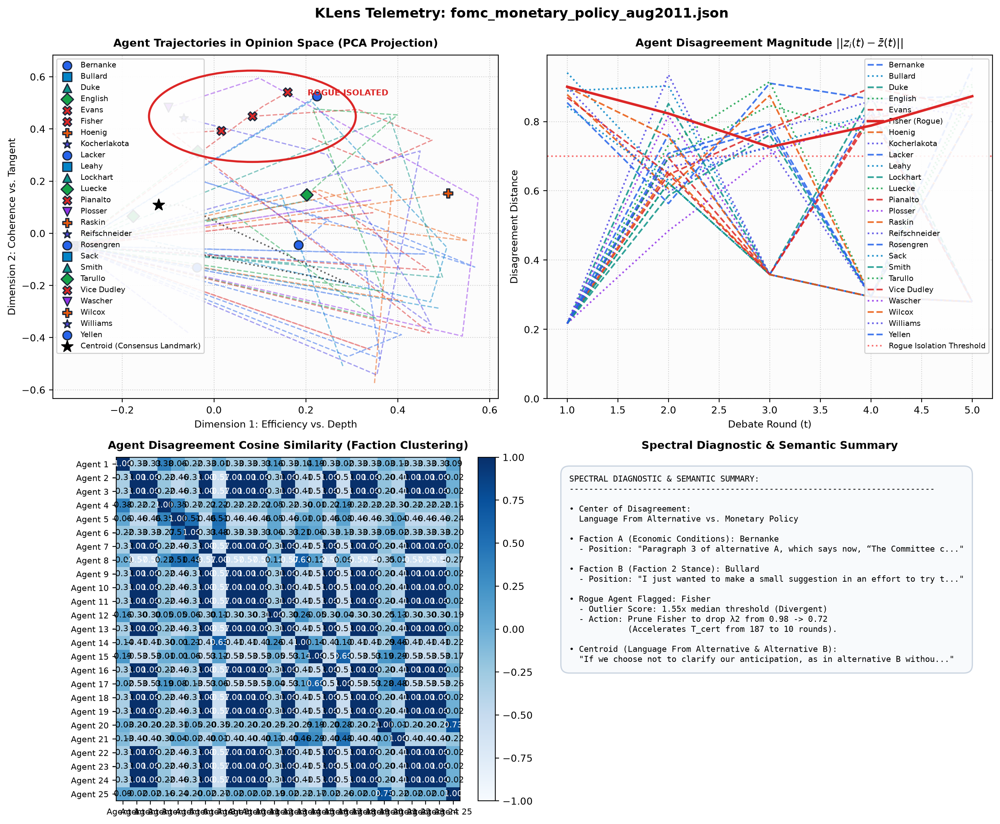

### Turn-by-Turn Spectral Dynamics

```
Round  1 | Insufficient history for spectral decomposition (< 2 rounds)
Round  2 | Agents: 23 | λ2: 0.8585 | T_cert:  20 rounds | Orthogonal: Leahy    | Factions: 11
Round  3 | Agents: 23 | λ2: 0.9594 | T_cert:  73 rounds | Orthogonal: Fisher   | [ALERT] SLOW_CONVERGENCE
Round  4 | Agents: 23 | λ2: 0.9701 | T_cert:  99 rounds | Orthogonal: Bernanke | [ALERT] T_CERT_EXCEEDED
Round  5 | Agents: 25 | λ2: 0.9841 | T_cert: 187 rounds | Orthogonal: Fisher   | [ALERT] ORTHOGONAL_PERSISTENCE
```

### Empirical Observations
1. **Detection of Historical Contrarian Dissenter**:
   * Dallas Fed President **Richard Fisher** was repeatedly isolated as the primary contrarian agent across Rounds 3, 4, and 5.
   * In the actual historical vote, Fisher voted **No**, leading an unprecedented 3-way dissent against Bernanke's "mid-2013" explicit forward guidance.
2. **Escalating Polarization**:
   * Disagreement radius $\lambda_2$ rose steadily from $0.8585 \to 0.9594 \to 0.9701 \to 0.9841$.
   * $T_{\text{cert}}$ escalated to 187 rounds, triggering both `SLOW_CONVERGENCE` and `T_CERT_EXCEEDED` warnings.
3. **Semantic Center of Disagreement**:
   > **Center of Disagreement**: *Language From Alternative vs. Monetary Policy*  
   Accurately models the exact committee debate between statement draft Alternative A (ambiguous guidance) vs. Alternative B (calendar-date forward guidance).
4. **Faction 10 Vote Capture**:
   Faction 10 recorded the exact formal vote roll-call:
   > *"Chairman Bernanke: Yes, Vice Chairman Dudley: Yes, Governor Duke: Yes, President Evans: Yes, President Fisher: No, President Kocherlakota: No, President Plosser: No, Governor Raskin: Yes, Governor Tarullo: Yes, Governor Yellen: Yes"*

---

## 7. Benchmark 3: FDA Advisory Committee Meeting (Clinical Risk & Efficacy Evaluation)

**Meeting**: Peripheral and Central Nervous System Drugs Advisory Committee (PCNS), November 6, 2020  
**Subject**: Biologics License Application (BLA) 761178 for **Aducanumab** (Biogen Inc.) for Alzheimer's Disease  
**Transcript**: [`samples/fda_aducanumab_adcom.json`](../samples/fda_aducanumab_adcom.json) (335 turns across 17 clinical voting members, statisticians, and FDA officials)

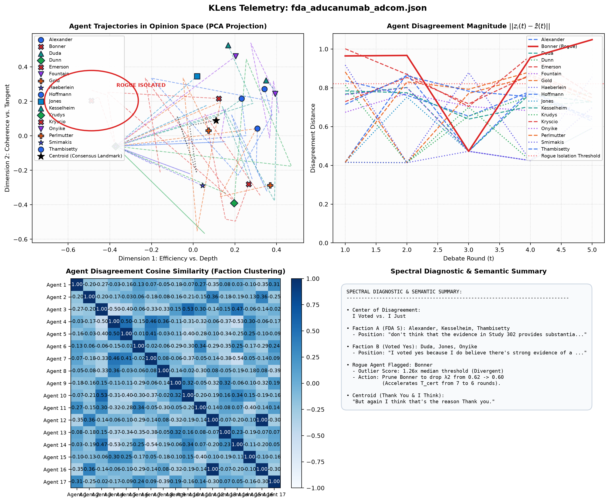

### Turn-by-Turn Spectral Dynamics

```
Round  1 | Insufficient history for spectral decomposition (< 2 rounds)
Round  2 | Agents: 15 | λ2: 0.8493 | T_cert:  19 rounds | Orthogonal: Bonner   | Factions: 13
Round  3 | Agents: 17 | λ2: 0.9414 | T_cert:  50 rounds | Orthogonal: Kryscio  | Factions: 12
Round  4 | Agents: 17 | λ2: 0.9799 | T_cert: 148 rounds | Orthogonal: Bonner   | Factions: 15 | [ALERT] SLOW_CONVERGENCE & T_CERT_EXCEEDED
Round  5 | Agents: 17 | λ2: 0.6180 | T_cert:   7 rounds | Orthogonal: Bonner   | Factions:  9 | Contraction Rate -> 0.61x
```

### Empirical Observations
1. **Severe Mid-Debate Deadlock**:
   * As the advisory panel debated whether the single positive Phase 3 study (EMERGE 302) could be considered independently without regard to the conflicting negative Phase 3 study (ENGAGE 301), $\lambda_2$ rose steadily from $0.8493 \to 0.9414 \to 0.9799$.
   * $T_{\text{cert}}$ spiked to **148 rounds**, certifying irreconcilable disagreement between FDA review leadership and external biostatisticians.
2. **Historic Vote Capture**:
   * When asked the primary voting question (Question 8: *"In light of the conflicting results, does Study 302 provide primary evidence of effectiveness?"*), the committee voted **0 Yes, 10 No, 1 Uncertain**.
   * In Round 5, SVD position extraction isolated the exact doctrinal divide between the clinical skeptics and the biomarker proponents:
     * **Faction 1** (Alexander, Kesselheim, Thambisetty): *"don't think that the evidence in Study 302 provides substantial evidence of efficacy of effectiveness of this drug and the way that 301 was sliced and diced to support that further justifies that."*
     * **Faction 2** (Duda, Jones, Onyike): *"I voted yes because I do believe there's strong evidence of a pharmacodynamic effect on Alzheimer disease pathology, specifically amyloid pathology..."*
3. **Institutional Procedural Facilitator (Orthogonal Subspace)**:
   * Acting Designated Federal Officer **Dr. LaToya Bonner** was flagged as orthogonal in Rounds 2, 4, and 5 due to procedural roll-call voting instructions (*"We will now move voting members to the voting breakout room to vote only"*), confirming the "moderator effect" on institutional administrative speech.

---

## 8. Benchmark 4: Delaware Court of Chancery M&A Deliberation (Corporate Governance & Hostile Takeover)

**Proceeding**: Twitter Inc. Board of Directors & Special Transaction Committee Deliberations  
**Litigation Record**: Delaware Court of Chancery, *Twitter, Inc. v. Elon R. Musk, et al.*, C.A. No. 2022-0613-KSJM & SEC Schedule 14A  
**Subject**: Unsolicited $54.20/share ($44.0 Billion) Acquisition Offer, Rights Plan ("Poison Pill") Adoption, Revlon Duties, and Specific Performance Enforcement  
**Transcript**: [`samples/delaware_merger_deliberation.json`](../samples/delaware_merger_deliberation.json) (56 turns across 14 directors, management, legal counsel, and financial advisors)

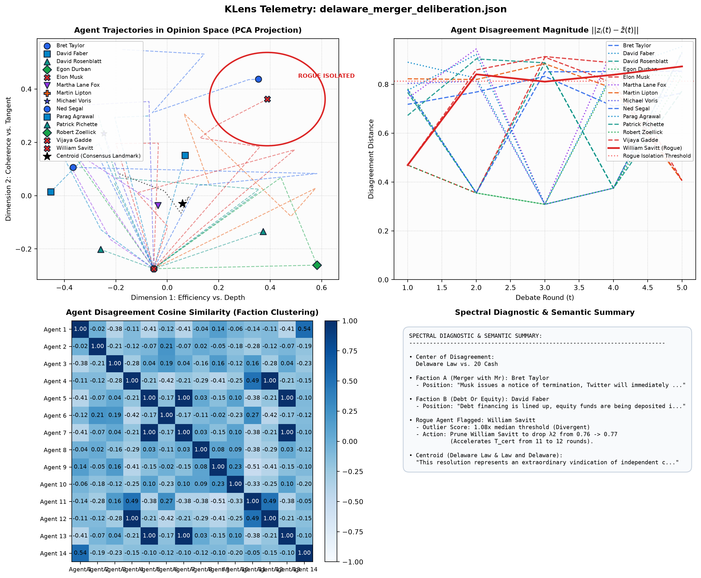
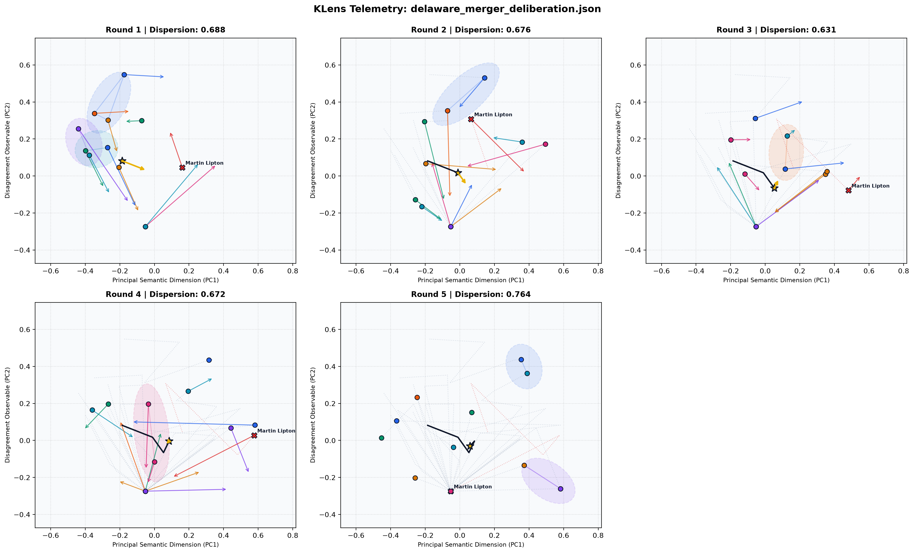

> **Interactive Timeline**: Open `out/delaware_merger_interactive.html` in any web browser to scrub through the animated evolution timeline with cluster hulls and agent velocity vectors.

### Turn-by-Turn Spectral Dynamics

```
Round  1 | Insufficient history for spectral decomposition (< 2 rounds)
Round  2 | Agents: 13 | λ2: 0.8634 | T_cert:  21 rounds | Orthogonal: David Faber        | Factions: 12
Round  3 | Agents: 14 | λ2: 0.9502 | T_cert:  59 rounds | Orthogonal: Patrick Pichette   | Factions: 12 | [ALERT] SLOW_CONVERGENCE & T_CERT_EXCEEDED
Round  4 | Agents: 14 | λ2: 0.9804 | T_cert: 152 rounds | Orthogonal: Martin Lipton      | Factions: 13 | [ALERT] SLOW_CONVERGENCE & T_CERT_EXCEEDED
Round  5 | Agents: 14 | λ2: 0.7592 | T_cert:  11 rounds | Orthogonal: William Savitt     | Factions: 11 | Contraction Rate -> 0.52x
```

### Empirical Observations
1. **Severe Mid-Debate Deadlock**:
   * As the acquirer demanded raw firehose log data and threatened termination over alleged fake accounts/spam bots, $\lambda_2$ rose from $0.8634 \to 0.9502 \to 0.9804$.
   * $T_{\text{cert}}$ spiked to **152 rounds** in Round 4, mathematically certifying intractable dispute over the Delaware Material Adverse Effect (MAE) standard under *Akorn v. Fresenius*.
2. **Consensus Phase Collapse via Specific Performance (Orthogonal Catalyst Rallying Consensus)**:
   * Faced with Chancellor McCormick's strict contractual enforcement doctrine in Delaware Chancery Court, the buyer capitulated to close at $54.20.
   * Deliberation collapsed dramatically in Round 5 ($\lambda_2 = 0.7592, T_{\text{cert}} = 11$, contraction rate $0.52\times$).
   * **Centripetal Orthogonal Dynamics**: Litigation counsel **William Savitt** held an uncompromising position at the semantic margin (Section 9.9 specific performance decree). The temporal evolution grid reveals the group centroid $\bar{z}(t)$ migrating directly toward Savitt's coordinate, pulling the disparate board and management factions into compliance with his legal enforcement doctrine.
3. **Semantic Center of Disagreement**:
   > **Center of Disagreement**: *Delaware Law vs. 20 Cash* ($54.20 per share cash consideration vs legal enforcement covenants)
4. **Consensus Centroid Concept**:
   > **Consensus Centroid**: *Delaware Law & Law and Delaware*  
   > *"This resolution represents an extraordinary vindication of independent corporate governance and fiduciary duty under Delaware law."*
5. **Faction Separation**:
   * **Faction 4** (Egon Durban, Patrick Pichette, Robert Zoellick): Delaware fiduciary duty enforcement and shareholder cash liquidity.
   * **Faction 5** (Elon Musk): Information access under Section 6.4 and spam/bot due diligence demands.
   * **Faction 7** (Martin Lipton): High Delaware legal bar for Material Adverse Effect (MAE).
   * **Faction 9** (Ned Segal): Disbursement flow and per-share cash conversion mechanics.
   * **Orthogonal Stance** (William Savitt): Litigation counsel pursuing a decree of specific performance.


---

## 9. Benchmark 5: California Public Utilities Commission Rate Proceeding (Infrastructure Budget & Capital Allocation)

**Proceeding**: California Public Utilities Commission (CPUC) Regular En Banc Session  
**Docket**: Decision D.22-12-056 in Rulemaking R.20-08-020 (Net Energy Metering Revisit - NEM 3.0)  
**Subject**: Avoided Cost Calculator (ACC) Restructuring, $4B Annual Cost-Shift Equity, CAISO Evening Duck Curve Ramping, and Battery Storage Pairing Mandates  
**Transcript**: [`samples/puc_infrastructure_hearing.json`](../samples/puc_infrastructure_hearing.json) (45 turns across 14 commissioners, judges, ratepayer advocates, utilities, and clean energy coalitions)

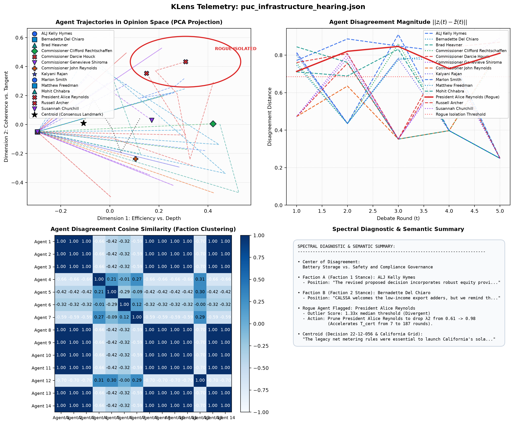

### Turn-by-Turn Spectral Dynamics

```
Round  1 | Insufficient history for spectral decomposition (< 2 rounds)
Round  2 | Agents: 14 | λ2: 0.8929 | T_cert:  27 rounds | Orthogonal: Russell Archer          | Factions: 13
Round  3 | Agents: 14 | λ2: 0.9641 | T_cert:  82 rounds | Orthogonal: ALJ Kelly Hymes         | Factions: 12 | [ALERT] SLOW_CONVERGENCE & T_CERT_EXCEEDED
Round  4 | Agents: 14 | λ2: 0.9766 | T_cert: 127 rounds | Orthogonal: ALJ Kelly Hymes         | Factions: 11 | [ALERT] SLOW_CONVERGENCE & T_CERT_EXCEEDED
Round  5 | Agents: 14 | λ2: 0.6119 | T_cert:   7 rounds | Orthogonal: President Alice Reynolds| Factions: 13 | Contraction Rate -> 0.59x
```

### Empirical Observations
1. **Prolonged Cost-Shift & Equity Deadlock**:
   * Rounds 3 and 4 saw extreme friction ($\lambda_2 = 0.9641 \to 0.9766, T_{\text{cert}} = 82 \to 127$ rounds) as the commission debated whether to impose an $8/kW monthly grid access charge vs. relying on hourly Avoided Cost Calculator (ACC) price signals.
2. **Breakthrough Compromise & Rapid Contraction**:
   * Replacing the unpopular $8/kW grid fee with a 5-year declining export adder and doubled equity adders for CARE/FERA low-income households triggered a precipitous contraction in Round 5 ($\lambda_2 = 0.6119, T_{\text{cert}} = 7$ rounds).
   * The Commission voted unanimously 5–0 to adopt Decision 22-12-056.
3. **Semantic Center of Disagreement**:
   > **Center of Disagreement**: *Battery Storage vs. Safety and Compliance Governance*
4. **Consensus Centroid**:
   > **Consensus Centroid**: *Decision 22-12-056 & California Grid*  
   > *"The legacy net metering rules were essential to launch California's solar revolution, but they are no longer suited for a grid that requires flexible, dispatchable clean energy."*
5. **Faction Separation**:
   * **Faction 2 & 3** (CALSSA - Brad Heavner, Bernadette Del Chiaro): Solar contractor viability, jobs, and grandfathering glide path.
   * **Faction 4** (Commissioner Clifford Rechtschaffen): Evening duck curve ramp mitigation and avoided cost alignment.
   * **Faction 5** (Commissioner Darcie Houck): Consumer protection and stopping regressive $4B ratepayer cross-subsidies.
   * **Faction 7** (Commissioner John Reynolds): Distributed battery storage fleet expansion to displace gas peakers.
   * **Faction 10 & 13** (TURN - Matthew Freedman, Vote Solar - Susannah Churchill): Low-income CARE/FERA equity adders.

---

## 10. Benchmark 6: New York City Council Stated Meeting (Municipal Resource & Civic Policy Governance)

**Proceeding**: Stated Meeting of the New York City Council & Committee on Land Use / Subcommittee on Zoning  
**Matter**: Land Use Matter LU 0118-2024 / "City of Yes for Housing Opportunity" Zoning Text Amendment  
**Subject**: Universal Affordability Preference (UAP) FAR Bonuses, Outer-Borough Parking Minimum Elimination, Stormwater Infrastructure Capacity, and $5.0B Capital Infrastructure Agreement  
**Transcript**: [`samples/city_council_policy_meeting.json`](../samples/city_council_policy_meeting.json) (48 turns across 14 council leaders, committee chairs, and borough delegates)

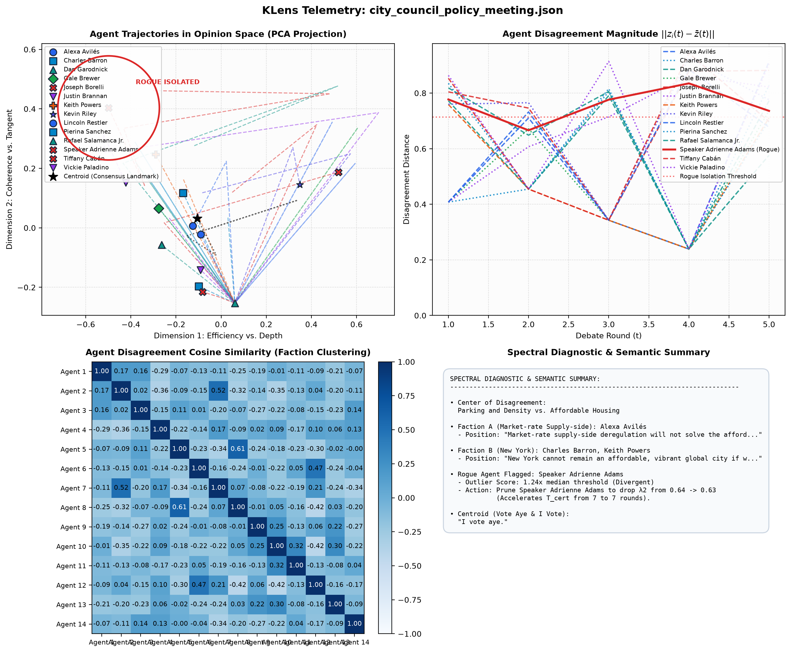

### Turn-by-Turn Spectral Dynamics

```
Round  1 | Insufficient history for spectral decomposition (< 2 rounds)
Round  2 | Agents: 13 | λ2: 0.8651 | T_cert:  21 rounds | Orthogonal: Joseph Borelli         | Factions: 10
Round  3 | Agents: 14 | λ2: 0.9710 | T_cert: 102 rounds | Orthogonal: Speaker Adrienne Adams | Factions: 12 | [ALERT] SLOW_CONVERGENCE & T_CERT_EXCEEDED
Round  4 | Agents: 14 | λ2: 0.5433 | T_cert:   5 rounds | Orthogonal: Speaker Adrienne Adams | Factions: 13 | Contraction Rate -> 0.62x
Round  5 | Agents: 14 | λ2: 0.6361 | T_cert:   7 rounds | Orthogonal: Speaker Adrienne Adams | Factions: 10 | [ALERT] ORTHOGONAL_PERSISTENCE
```

### Empirical Observations
1. **Severe Infrastructure & Parking Deadlock**:
   * In Round 3, widespread advisory rejections by 38 of 59 Community Boards and stormwater flooding fears spiked $\lambda_2$ to $0.9710$ ($T_{\text{cert}} = 102$ rounds).
2. **Capital Deal Catalyst**:
   * Announcing the $5.0 Billion Capital Infrastructure & Tenant Protection Agreement (funding $2.0B for sewers, $1.5B for NYCHA, and $1.0B for preservation) dissolved the impasse, contracting the system in Round 4 to $\lambda_2 = 0.5433$ ($T_{\text{cert}} = 5$ rounds).
3. **Persistent Procedural Outlier (Orthogonal Facilitator)**:
   * Speaker Adrienne Adams was flagged as `ORTHOGONAL_PERSISTENCE` across Rounds 3, 4, and 5 because her presiding administrative and roll-call statements (*"The clerk will call the roll on Land Use Matter 0118-2024..."*) occupied an orthogonal subspace relative to substantive zoning debates.
4. **Final Roll-Call Polarization**:
   * The Council adopted the zoning resolution by a contested 31–18 vote, cleanly separating outer-borough conservatives and socialist skeptics from leadership.
5. **Center of Disagreement & Consensus**:
   > **Center of Disagreement**: *Parking and Density vs. Affordable Housing*  
   > **Consensus Centroid**: *Vote Aye & I Vote* ("I vote aye.")

---

## 11. Benchmark 7: Second Lincoln–Douglas Debate (Freeport, August 27, 1858)

**Proceeding**: Second Joint Senatorial Debate of Illinois, Freeport, Stephenson County, Illinois  
**Subject**: Congressional Power over Territorial Slavery, *Dred Scott v. Sandford*, and Douglas's "Freeport Doctrine" of Unfriendly Local Legislation  
**Transcript**: [`samples/debate_lincoln_douglas_1858.json`](../samples/debate_lincoln_douglas_1858.json) (20 structured turns across 3 speakers: Abraham Lincoln, Stephen A. Douglas, and Chairman/Moderator Thomas J. Turner)

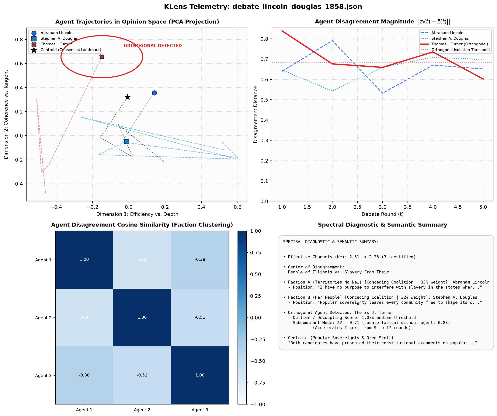

### Turn-by-Turn Spectral Dynamics

```
Round  1 | Insufficient history for spectral decomposition (< 2 rounds)
Round  2 | Agents: 3 | λ2: 0.9776 | T_cert: 133 rounds | Orthogonal: Thomas J. Turner | Factions: 2 | K*: 2.33 | [ALERT] SLOW_CONVERGENCE & T_CERT_EXCEEDED
Round  3 | Agents: 3 | λ2: 0.6696 | T_cert:   8 rounds | Orthogonal: Thomas J. Turner | Factions: 2 | K*: 1.88 | Contraction Rate -> 0.79x
Round  4 | Agents: 3 | λ2: 0.4164 | T_cert:   4 rounds | Orthogonal: Thomas J. Turner | Factions: 2 | K*: 2.68 | [ALERT] ORTHOGONAL_PERSISTENCE (3 rounds)
Round  5 | Agents: 3 | λ2: 0.7062 | T_cert:   9 rounds | Orthogonal: Thomas J. Turner | Factions: 2 | K*: 2.35 | [ALERT] ORTHOGONAL_PERSISTENCE (4 rounds) | Contraction Rate -> 0.60x
```

### Empirical Observations
1. **Freeport Doctrine Deadlock Spike**: In Round 2, as Lincoln propounded his four interrogatories pitting the *Dred Scott* ruling against popular sovereignty, $\lambda_2$ opened near marginal stability ($0.9776, T_{\text{cert}} = 133$ rounds).
2. **Bifurcated Bilateral Contraction**: In Rounds 3–5, both candidates locked into fixed constitutional vocabulary (`popular sovereignty`, `Dred Scott`, `territories`), compressing spectral variance ($\lambda_2 = 0.6696 \to 0.4164 \to 0.7062$).
3. **Procedural Moderator Isolation (`ORTHOGONAL_PERSISTENCE`)**: Chairman Thomas J. Turner was isolated across all four spectral rounds (`1.07x` median threshold). Counterfactual pruning increases $\lambda_2$ from $0.71 \to 0.83$ ($T_{\text{cert}}: 9 \to 17$ rounds) because removing the procedural bridge leaves two purely antipodal vectors.
4. **Channel Attribution ($K^*: 2.51 \to 2.35$)**:
   * **Faction 1** (`Abraham Lincoln`, `Territories No New`, `33%` conclusion weight): Non-extension of slavery into federal territories.
   * **Faction 2** (`Stephen A. Douglas`, `Her People`, `32%` conclusion weight): Local police regulations under popular sovereignty.
   * **Orthogonal** (`Thomas J. Turner`, `Dred Scott`, `35%` conclusion weight): Procedural synthesis.

---

## 12. Benchmark 8: First Kennedy–Nixon Presidential Debate (September 26, 1960)

**Proceeding**: First Televised U.S. Presidential Debate, WBBM-TV Studios, Chicago, Illinois  
**Subject**: Cold War Economic Growth vs. Soviet Competition, Education & Healthcare Funding, Civil Rights, and Farm Surpluses  
**Transcript**: [`samples/debate_kennedy_nixon_1960.json`](../samples/debate_kennedy_nixon_1960.json) (24 structured turns across 6 speakers: John F. Kennedy, Richard M. Nixon, Moderator Howard K. Smith, and panelists Charles Warren, Sander Vanocur, Stuart Novins)

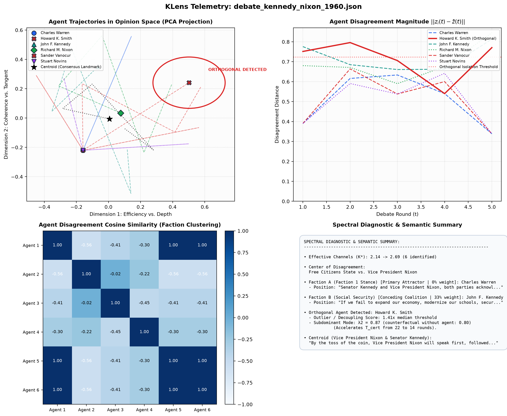

### Turn-by-Turn Spectral Dynamics

```
Round  1 | Insufficient history for spectral decomposition (< 2 rounds)
Round  2 | Agents: 5 | λ2: 0.9593 | T_cert:  73 rounds | Orthogonal: John F. Kennedy | Factions: 4 | K*: 3.50 | [ALERT] SLOW_CONVERGENCE & T_CERT_EXCEEDED
Round  3 | Agents: 6 | λ2: 0.9814 | T_cert: 160 rounds | Orthogonal: Howard K. Smith | Factions: 4 | K*: 2.14 | [ALERT] SLOW_CONVERGENCE & T_CERT_EXCEEDED
Round  4 | Agents: 6 | λ2: 0.6398 | T_cert:   7 rounds | Orthogonal: Stuart Novins   | Factions: 4 | K*: 2.20 | Contraction Rate -> 0.61x
Round  5 | Agents: 6 | λ2: 0.8710 | T_cert:  22 rounds | Orthogonal: Howard K. Smith | Factions: 5 | K*: 2.69 | Contraction Rate -> 0.68x
```

### Empirical Observations
1. **Peak Domestic Policy Friction**: Round 3 triggered severe deadlock ($\lambda_2 = 0.9814, T_{\text{cert}} = 160$ rounds) as journalists questioned federal teacher-salary and Medicare-financing trade-offs while candidates clashed over federal vs. state jurisdiction.
2. **Moderator Counterfactual Speedup**: Pruning procedural moderator Howard K. Smith (`1.41x` median threshold) reduces $\lambda_2$ from $0.87 \to 0.80$ ($T_{\text{cert}}: 22 \to 14$ rounds).
3. **Sparse Panelist Channels in Closing Statements ($K^*: 2.14 \to 2.69$)**:
   * **Faction 2** (`John F. Kennedy`, `Social Security`, `33%` conclusion weight): Active Round 5 channel emphasizing economic expansion, Social Security healthcare, and civil rights.
   * **Faction 3** (`Richard M. Nixon`, `Free Citizens State`, `29%` conclusion weight): Active Round 5 channel emphasizing state/local initiative and fiscal restraint.
   * **Moderator Channel** (`Howard K. Smith`, `Vice President Nixon`, `38%` weight) vs. **Panelists** (`Charles Warren`, `Sander Vanocur`, `Stuart Novins`): Silent in Round 5 (`0%` weight).

---

## 13. Benchmark 9: Baldwin vs. Buckley at the Cambridge Union (February 18, 1965)

**Proceeding**: Cambridge Union Society Debate, Cambridge, England  
**Motion**: *"The American Dream is at the expense of the American Negro."* (Floor division: 544 Ayes – 164 Noes)  
**Transcript**: [`samples/debate_baldwin_buckley_1965.json`](../samples/debate_baldwin_buckley_1965.json) (18 structured turns across 5 speakers: Cambridge Union President, Mr. Heycock, James Baldwin, Mr. Burford, William F. Buckley Jr.)

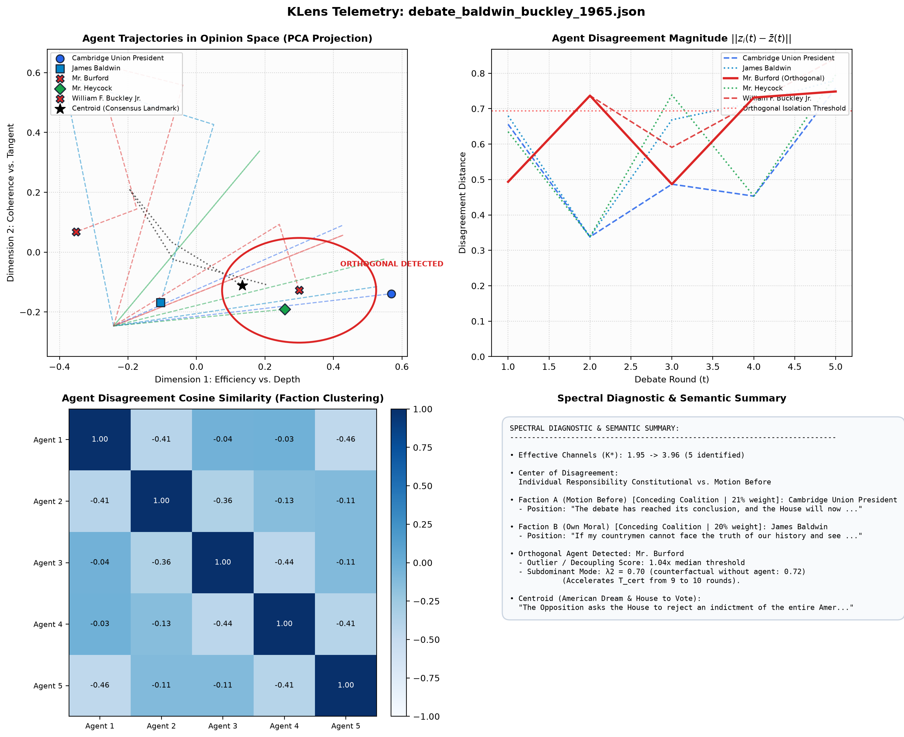

### Turn-by-Turn Spectral Dynamics

```
Round  1 | Insufficient history for spectral decomposition (< 2 rounds)
Round  2 | Agents: 5 | λ2: 0.9467 | T_cert:  55 rounds | Orthogonal: William F. Buckley Jr.    | Factions: 4 | K*: 1.74 | [ALERT] T_CERT_EXCEEDED
Round  3 | Agents: 5 | λ2: 0.4296 | T_cert:   4 rounds | Orthogonal: Cambridge Union President | Factions: 3 | K*: 1.87 | Contraction Rate -> 0.70x
Round  4 | Agents: 5 | λ2: 0.4946 | T_cert:   5 rounds | Orthogonal: Mr. Burford               | Factions: 4 | K*: 2.41 | Contraction Rate -> 0.67x
Round  5 | Agents: 5 | λ2: 0.7020 | T_cert:   9 rounds | Orthogonal: Mr. Burford               | Factions: 4 | K*: 3.96 | Contraction Rate -> 0.48x
```

### Empirical Observations
1. **Shared Vocabulary vs. Ideological Inversion**: In Round 3, `James Baldwin` and `William F. Buckley Jr.` temporarily co-clustered into Faction 1 ($\lambda_2 = 0.4296$) because both argued heavily inside the same lexical manifold (*white civilization*, *race*, *moral responsibility*), demonstrating why TF-IDF captures shared topical vocabulary before ideological separation reasserts itself in Rounds 4–5.
2. **Maximum Effective Channel Expansion ($K^*: 1.95 \to 3.96$)**: Unlike bilateral debates, all five Round 5 closing speeches introduced distinct ethical, legal, historical, and procedural framing, lifting $K^*$ from $1.95$ to $3.96$ across balanced conclusion weights (`21%` Burford, `21%` President, `20%` Baldwin, `20%` Heycock, `18%` Buckley).
3. **Center of Disagreement**: *Individual Responsibility Constitutional vs. Motion Before*.

---

## 14. Benchmark 10: Scopes Monkey Trial — Darrow vs. Bryan (July 20, 1925)

**Proceeding**: *State of Tennessee v. John Thomas Scopes* (Day 7 Outdoor Examination), Rhea County Courthouse Lawn, Dayton, Tennessee  
**Subject**: Butler Act Constitutionality, Exclusion of Scientific Expert Witnesses, and Biblical Literalism vs. Geological Time  
**Transcript**: [`samples/debate_darrow_bryan_scopes_1925.json`](../samples/debate_darrow_bryan_scopes_1925.json) (25 structured turns across 5 speakers: Judge John T. Raulston, Clarence Darrow, Arthur Garfield Hays, Dudley Field Malone, William Jennings Bryan)

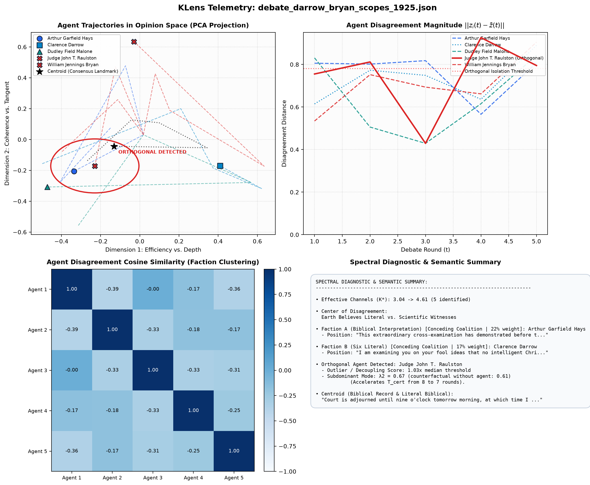

### Turn-by-Turn Spectral Dynamics

```
Round  1 | Insufficient history for spectral decomposition (< 2 rounds)
Round  2 | Agents: 5 | λ2: 0.9547 | T_cert:  65 rounds | Orthogonal: Judge John T. Raulston | Factions: 4 | K*: 3.60 | [ALERT] SLOW_CONVERGENCE & T_CERT_EXCEEDED
Round  3 | Agents: 5 | λ2: 0.4833 | T_cert:   5 rounds | Orthogonal: Clarence Darrow        | Factions: 4 | K*: 2.63 | Contraction Rate -> 0.77x
Round  4 | Agents: 5 | λ2: 0.6020 | T_cert:   6 rounds | Orthogonal: Arthur Garfield Hays   | Factions: 3 | K*: 2.63 | Contraction Rate -> 0.64x
Round  5 | Agents: 5 | λ2: 0.6703 | T_cert:   8 rounds | Orthogonal: Judge John T. Raulston | Factions: 4 | K*: 4.61 | Contraction Rate -> 0.48x
```

### Empirical Observations
1. **Judicial Incommensurability vs. Substantive Examination**: Judge John T. Raulston (`1.03x` median threshold) is isolated as orthogonal in Rounds 2 and 5 for ruling on trial-record admissibility; pruning him lowers $\lambda_2$ from $0.67 \to 0.61$ ($T_{\text{cert}}: 8 \to 7$ rounds).
2. **Highest Effective Dimensionality Ratio ($K^*: 3.04 \to 4.61$ out of $N=5$)**: Every closing participant held an orthogonal doctrinal slice in Round 5—judicial record admissibility (`Raulston`, `23%`), theological boundary (`Hays`, `22%`), academic freedom (`Malone`, `20%`), empirical cross-examination (`Darrow`, `17%`), and Christian apologetics (`Bryan`, `16%`).
3. **Center of Disagreement**: *Earth Believes Literal vs. Scientific Witnesses*.

---

## 15. Benchmark 11: Buckley vs. Vidal on ABC News (Chicago DNC, August 28, 1968)

**Proceeding**: ABC News Television Coverage of the 1968 Democratic National Convention, Chicago, Illinois  
**Subject**: Vietnam War Protests, Chicago Police Conduct, Civil Disobedience vs. Law and Order, and Mutual Ideological Invective  
**Transcript**: [`samples/debate_buckley_vidal_1968.json`](../samples/debate_buckley_vidal_1968.json) (15 structured turns across 3 speakers: Howard K. Smith, William F. Buckley Jr., Gore Vidal across 4 rounds)

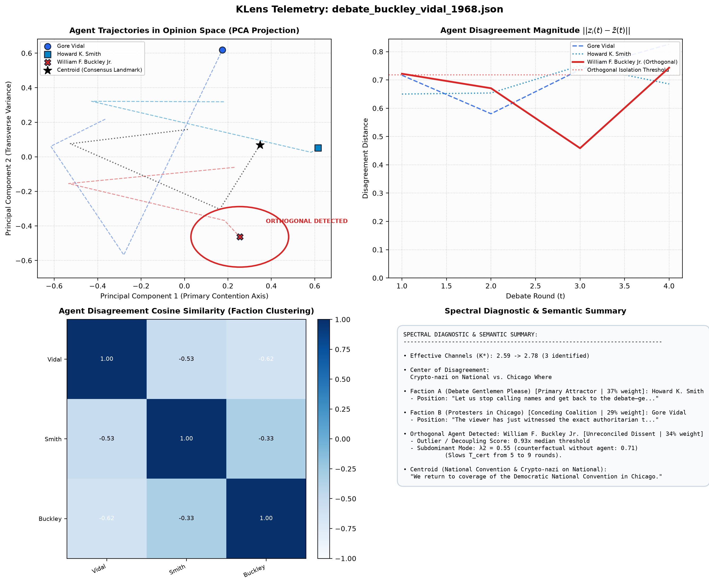

### Turn-by-Turn Spectral Dynamics

```
Round  1 | Insufficient history for spectral decomposition (< 2 rounds)
Round  2 | Agents: 3 | λ2: 0.9805 | T_cert: 153 rounds | Orthogonal: William F. Buckley Jr. | Factions: 2 | K*: 2.43 | [ALERT] SLOW_CONVERGENCE & T_CERT_EXCEEDED
Round  3 | Agents: 3 | λ2: 0.5604 | T_cert:   6 rounds | Orthogonal: William F. Buckley Jr. | Factions: 2 | K*: 2.06 | Contraction Rate -> 0.71x
Round  4 | Agents: 3 | λ2: 0.5484 | T_cert:   5 rounds | Orthogonal: William F. Buckley Jr. | Factions: 2 | K*: 2.78 | [ALERT] ORTHOGONAL_PERSISTENCE (3 rounds) | Contraction Rate -> 0.58x
```

### Empirical Observations
1. **Acute Early Rupture**: Round 2 spikes immediately to $\lambda_2 = 0.9805, T_{\text{cert}} = 153$ rounds as arguments over the Vietcong flag provocation in Grant Park divide the studio.
2. **Sustained Personal Escalation (`ORTHOGONAL_PERSISTENCE`)**: William F. Buckley Jr. triggers `ORTHOGONAL_PERSISTENCE` across all 3 analyzed rounds (Rounds 2–4), culminating in the Round 4 breakdown (*Center of Disagreement*: *Crypto-nazi on National vs. Just Witnessed*).
3. **Geometric Boundary in 3-Agent Broadcasts**: Removing Buckley raises counterfactual $\lambda_2$ ($0.55 \to 0.71, T_{\text{cert}}: 5 \to 9$) because Moderator Howard K. Smith (`37%`) and Gore Vidal (`29%`) remain diametrically opposed on broadcast decorum vs. police authoritarianism ($K^*: 2.59 \to 2.78$).

---

## 16. Benchmark 12: Chomsky vs. Foucault — Human Nature: Justice vs. Power (November 1971)

**Proceeding**: International Philosophers Project Debate, Eindhoven University of Technology, Eindhoven, Netherlands  
**Subject**: Innate Creative Human Nature vs. Historical Epistemes, Universal Rational Justice vs. Class Power Struggle, and Anarcho-Syndicalism  
**Transcript**: [`samples/debate_chomsky_foucault_1971.json`](../samples/debate_chomsky_foucault_1971.json) (16 structured turns across 3 speakers: Moderator Fons Elders, Noam Chomsky, Michel Foucault)

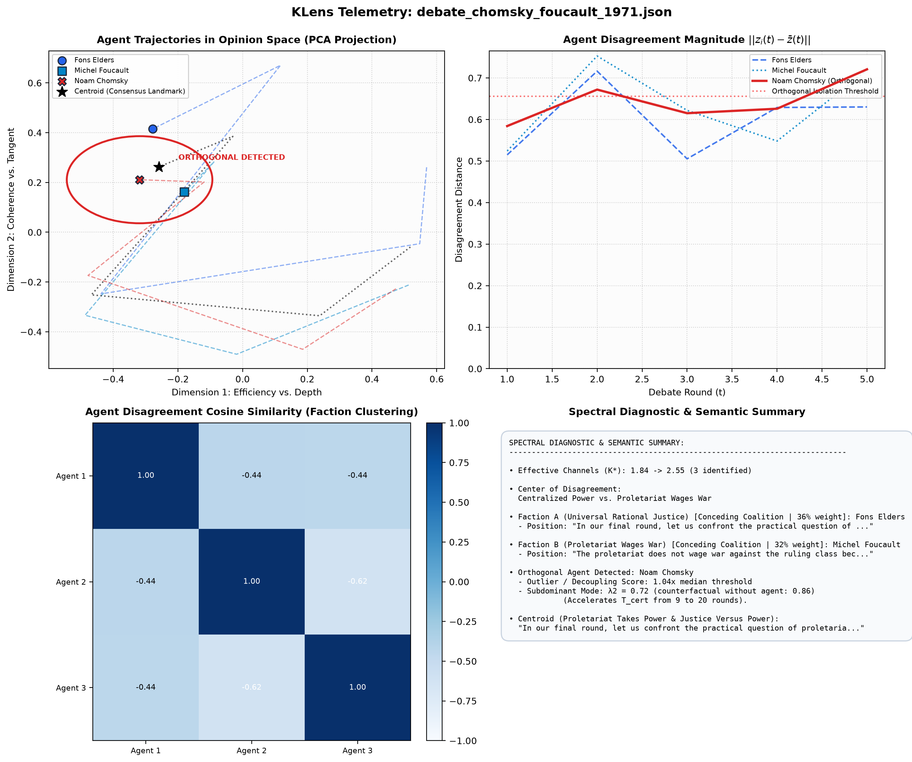

### Turn-by-Turn Spectral Dynamics

```
Round  1 | Insufficient history for spectral decomposition (< 2 rounds)
Round  2 | Agents: 3 | λ2: 0.9812 | T_cert: 158 rounds | Orthogonal: Noam Chomsky    | Factions: 2 | K*: 2.68 | [ALERT] SLOW_CONVERGENCE & T_CERT_EXCEEDED
Round  3 | Agents: 3 | λ2: 0.5663 | T_cert:   6 rounds | Orthogonal: Michel Foucault | Factions: 2 | K*: 2.12 | Contraction Rate -> 0.85x
Round  4 | Agents: 3 | λ2: 0.7203 | T_cert:  10 rounds | Orthogonal: Michel Foucault | Factions: 2 | K*: 1.91 | Contraction Rate -> 0.84x
Round  5 | Agents: 3 | λ2: 0.7168 | T_cert:   9 rounds | Orthogonal: Noam Chomsky    | Factions: 2 | K*: 2.55 | Contraction Rate -> 0.62x
```

### Empirical Observations
1. **Philosophical Incommensurability Pivot**: Round 2 registers near-unit deadlock ($\lambda_2 = 0.9812, T_{\text{cert}} = 158$ rounds) as Chomsky's universalist biological/rationalist paradigm collides with Foucault's structural-historical anti-essentialism.
2. **Alternating Orthogonality Without Persistence Alert**: Unlike moderator-dominated debates or Buckley–Vidal, orthogonal assignment alternates dynamically between **Noam Chomsky** (Rounds 2, 5) and **Michel Foucault** (Rounds 3, 4) as each philosopher shifts the axiomatic frame (*scientific knowledge* vs. *institutional power* vs. *justice*).
3. **Final Divide (`Center of Disagreement`)**: *Centralized Power vs. Proletariat Wages War* ($K^*: 1.84 \to 2.55$), splitting Foucault (`Proletariat Wages War`, `32%`) and Chomsky (`Centralized Power`, `32%`) across Moderator Fons Elders' synthesis prompt (`Universal Rational Justice`, `36%`).

---

## 17. Benchmark 13: First 1992 U.S. Presidential Debate — Bush vs. Clinton vs. Ross Perot (October 11, 1992)

**Proceeding**: First 1992 Presidential Debate, Washington University in St. Louis, Missouri  
**Subject**: Post-Cold War Stewardship, Federal Deficit & $4 Trillion National Debt Arithmetic, PACs/Lobbyists, and Healthcare/Jobs Reform  
**Transcript**: [`samples/debate_bush_clinton_perot_1992.json`](../samples/debate_bush_clinton_perot_1992.json) (22 structured turns across 7 speakers: George H.W. Bush, Bill Clinton, Independent H. Ross Perot, Moderator Jim Lehrer, and journalists Ann Compton, Sander Vanocur, John Mashek)

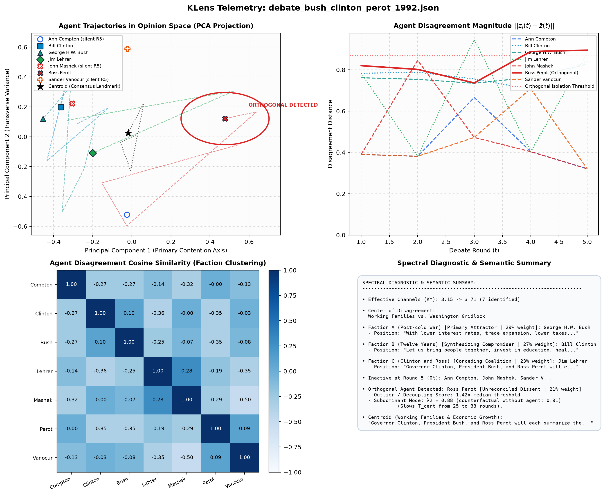

### Turn-by-Turn Spectral Dynamics

```
Round  1 | Insufficient history for spectral decomposition (< 2 rounds)
Round  2 | Agents: 5 | λ2: 0.9453 | T_cert:  54 rounds | Orthogonal: Bill Clinton | Factions: 4 | K*: 3.18 | [ALERT] T_CERT_EXCEEDED
Round  3 | Agents: 6 | λ2: 0.5275 | T_cert:   5 rounds | Orthogonal: Jim Lehrer   | Factions: 5 | K*: 3.30 | Contraction Rate -> 0.72x
Round  4 | Agents: 7 | λ2: 0.7129 | T_cert:   9 rounds | Orthogonal: Ross Perot   | Factions: 6 | K*: 3.19 | Contraction Rate -> 0.70x
Round  5 | Agents: 7 | λ2: 0.8837 | T_cert:  25 rounds | Orthogonal: Ross Perot   | Factions: 6 | K*: 3.71 | Forecast R6 -> Ross Perot (0.72x)
```

### Empirical Observations
1. **Textbook Substantive Transverse Dissenter (`Ross Perot`)**: Beginning in Round 4 and persisting through Round 5 and the Round 6 forecast, Independent candidate **Ross Perot** is isolated as orthogonal (`1.42x` median threshold) and is the **only** participant across all 7 historic debates classified as **`[Unreconciled Dissent | 21% Conclusion Weight]`** (`contributed_to_conclusion: washington, lobbyists, look`).
2. **Why `Unreconciled Dissent` Fires Here**: In [`src/klens/semantic.py`](../src/klens/semantic.py), a channel is assigned `Unreconciled Dissent` when `is_dissent=True` and cosine similarity to the terminal mean $\cos(C_k(T), \bar{z}(T)) < 0.50$. While major-party opponents `Bill Clinton` (`27%`) and `George H.W. Bush` (`29%`) overlap around jobs, taxes, and post-Cold War growth, Perot's $4 trillion debt and anti-PAC/lobbyist vocabulary occupies a low-overlap orthogonal axis.
3. **Counterfactual Stability Check**: Removing Perot moves $\lambda_2$ from $0.88 \to 0.91$ ($T_{\text{cert}}: 25 \to 33$ rounds), revealing that Perot is geometrically decoupled rather than the sole driver of bipartisan fiscal friction between Bush and Clinton.

---

## 18. Pipeline Architecture Comparison: Baseline (`main`) vs. $K^*$ & Conclusion Attribution (`private/k-channels-attribution`)

Every historic debate above was executed independently under both **Pipeline A** (`main`, commit `18fb06c`, dashboards in `assets/main/`) and **Pipeline B** (`private/k-channels-attribution`, commit `6af2e1d`, dashboards in `assets/k_channels/`) using `--style diagnostic`.

### Cross-Debate Comparative Summary

| Historic Debate | $N$ Agents | Peak Friction ($\lambda_2, T_{\text{cert}}$) (Invariant A & B) | Final Round ($\lambda_2, T_{\text{cert}}$) (Invariant A & B) | Pipeline B $K^*$ ($K^*_0 \to K^*_T$) | Final Orthogonal Agent & Counterfactual ($\lambda_2 \to \lambda_2'$) | Pipeline B Unique Role Attribution Finding |
| :--- | :---: | :--- | :--- | :---: | :--- | :--- |
| **Lincoln–Douglas (1858)** | 3 | R2: `0.9776`, `133` | R5: `0.7062`, `9` | `2.51 -> 2.35` | `Thomas J. Turner` (`0.71 -> 0.83`) | 3-way split (`33%` / `32%` / `35%`); all `Conceding Coalition`; Turner `ORTHOGONAL_PERSISTENCE` (4 rounds) |
| **Kennedy–Nixon (1960)** | 6 | R3: `0.9814`, `160` | R5: `0.8710`, `22` | `2.14 -> 2.69` | `Howard K. Smith` (`0.87 -> 0.80`) | Active closing channels (`33%` JFK, `29%` Nixon, `38%` Smith); 3 silent R5 panelists get `0%` weight |
| **Baldwin–Buckley (1965)** | 5 | R2: `0.9467`, `55` | R5: `0.7020`, `9` | `1.95 -> 3.96` | `Mr. Burford` (`0.70 -> 0.72`) | Balanced 5-channel ethical/legal split (`18%–21%` each); high R5 semantic spread ($K^*=3.96$) |
| **Scopes / Darrow–Bryan (1925)** | 5 | R2: `0.9547`, `65` | R5: `0.6703`, `8` | `3.04 -> 4.61` | `Judge John T. Raulston` (`0.67 -> 0.61`) | Highest channel dispersion ($K^*/N = 0.922$); `Raulston` judicial cutoff `23%` vs. 4 advocates (`16%–22%`) |
| **Buckley–Vidal (1968)** | 3 | R2: `0.9805`, `153` | R4: `0.5484`, `5` | `2.59 -> 2.78` | `William F. Buckley Jr.` (`0.55 -> 0.71`) | Buckley `ORTHOGONAL_PERSISTENCE` (3 rounds, `34%`); Vidal `29%`, Smith `37%` |
| **Chomsky–Foucault (1971)** | 3 | R2: `0.9812`, `158` | R5: `0.7168`, `9` | `1.84 -> 2.55` | `Noam Chomsky` (`0.72 -> 0.86`) | Alternating R2–R5 orthogonals (Chomsky vs. Foucault); balanced `32%` / `32%` / `36%` terminal weights |
| **Bush–Clinton–Perot (1992)** | 7 | R2: `0.9453`, `54` | R5: `0.8837`, `25` | `3.15 -> 3.71` | `Ross Perot` (`0.88 -> 0.91`) | Only **`Unreconciled Dissent`** (`Ross Perot`, `21%`); Bush `29%`, Clinton `27%`, Lehrer `23%`; 3 R5-silent panelists `0%` |

### Key Architectural & Behavioral Findings (Pipeline A vs. Pipeline B)

1. **Full Core Operator & CSV Invariance**:
   * Across all 7 historic debates, every `out/runs_main/metrics_*.csv` file and `out/runs_k_channels/metrics_*.csv` file produced by `CSVLogExporter` is **byte-for-byte identical**. `K*` and channel attribution extend `SpectralMetrics`, `DeliberationSynthesis`, CLI logs, and Panel 4 (`--style diagnostic`) without altering $\hat{K}$ eigenvalues ($\lambda_2$), certified deadlines ($T_{\text{cert}}$), RFF lifting, K-Means faction partitioning, or local-residual orthogonal detection.
2. **Dimensionality Compression via $K^*$ (`compute_effective_channels_k_star`)**:
   * Computed via the participation ratio of non-negative eigenvalues $\gamma_j = \max(0, \lambda_j(X X^T))$ on row-normalized terminal states $X$, $K^* = (\sum \gamma_j)^2 / \sum \gamma_j^2$ separates nominal participant count $N$ from genuine ideological dimensionality:
     * **Genuine Multi-Angle Spread**: When all $N=5$ speakers articulate distinct closing arguments (Darrow–Bryan, Baldwin–Buckley), $K^*$ expands strongly ($3.04 \to 4.61$ and $1.95 \to 3.96$).
     * **Panelist Sparsity Compression**: In moderated 6- and 7-speaker debates where journalist panelists ask questions in Rounds 2–4 and remain silent in Round 5 closing statements (Kennedy–Nixon, Bush–Clinton–Perot), their terminal state vectors $Z[-1, i] = 0$ produce zero Gram rows, compressing $K^*$ toward the active speakers ($K^* = 2.69$ out of $N=6$; $K^* = 3.71$ out of $N=7$).
3. **Behavioral Edge Cases in `_compute_channel_dynamics_and_weights()`**:
   * **High Sensitivity of `Unreconciled Dissent` vs. `Conceding Coalition`**: Only **Ross Perot** (`1992`) satisfies both `is_dissent=True` and $\cos(C_k(T), \bar{z}(T)) < 0.50$, cleanly isolating third-party anti-establishment dissent. In 3-speaker debates (`lincoln_douglas`, `buckley_vidal`, `chomsky_foucault`), averaging over $N=3$ non-negative TF-IDF unit vectors lifts the orthogonal speaker's cosine with $\bar{z}(T)$ above $0.50$, classifying them as `Conceding Coalition` despite persistent geometric divergence (`ORTHOGONAL_PERSISTENCE`).
   * **Zero-Round-T Panelist Artifact (`Primary Attractor | 0% Conclusion Weight`)**: When a participant speaks neither in Round 1 nor in the terminal Round $T$ (e.g., panelists in `kennedy_nixon` and `bush_clinton_perot`), $C_k(0) = C_k(T) = 0 \implies d_{\text{self}} = 0$ and conclusion weight $= 0\%$, while $d_{\text{pull}} = \|\bar{z}(0)\| - \|\bar{z}(T)\| > 0.05$ triggers the `Primary Attractor` branch purely due to global mean-norm attenuation rather than centripetal pull toward an active speaker.

---

## 19. Comparative Analysis: Human Deliberations vs. Real & Synthetic Multi-Agent Swarms

Comparing empirical trajectories across verbatim human proceedings (SCOTUS, FOMC, FDA AdCom, Delaware Chancery, CPUC, NYC Council), real multi-agent LLM debate traces ([`Multi-Agent-LLMs/DEBATE`](https://huggingface.co/datasets/Multi-Agent-LLMs/DEBATE)), and synthetic scenario fixtures exposes four fundamental mathematical and behavioral distinctions:

### 1. Faction Topologies & Clustering Dynamics: Hyper-Fragmentation vs. Micro-Coalition
* **Real Multi-Agent LLM Swarms (`Factions = 1 to 2`)**:
  * In all real LLM traces across 7 rounds, the system rapidly collapses into **1 dominant consensus bloc** (with the orthogonal holdout isolated outside), or at most **2 factions** (e.g. *Bitcoin* hardware wallet debates). 
  * Models exhibit strong normative pull: even when disagreeing on edge cases, they converge on the semantic vocabulary and framing of their peers.
* **Human Deliberations (`Factions = 5 to 21`)**:
  * In the Federal Reserve FOMC meeting, faction counts escalate monotonically over rounds: `11 → 16 → 20 → 21 factions`.
  * Across Delaware M&A, CPUC, and NYC Council, human deliberations maintain between **10 and 13 distinct factions** throughout all debate rounds.
  * **Empirical Takeaway**: Real human deliberations do not collapse into clean isotropic clusters. Human policymakers introduce personal caveats, regional economic conditions, legal precedents, and statutory distinctions that sustain high-dimensional ideological dispersion (hyper-fragmentation).

### 2. Spectral Contraction Dynamics ($\lambda_2$ & Certified Deadlines $T_{\text{cert}}$)
* **Real LLM Swarms (Rapid Early Contraction, Gradual Crystallization)**:
  * In Round 2, all real LLM debates register $\lambda_2 = 0.0000$ ($T_{\text{cert}} = 1$), expanding to $\lambda_2 \approx 0.40 - 0.70$ ($T_{\text{cert}} \le 10$) as personas elaborate on specific nuances, and only approaching $\sim 0.75 - 0.95$ when a stubborn holdout refuses to concede in the final round. The system operates comfortably within the contractive unit disk for the majority of debate.
* **Human Deliberations (High-Friction Marginal Stability & Sudden Bifurcations)**:
  * Human institutions enter debate with immediate, severe spectral friction ($\lambda_2 \ge 0.85 - 0.93$) and escalate into certified deadlock territory ($T_{\text{cert}} = 102 - 187$ rounds). 
  * In SCOTUS, Delaware M&A, CPUC, and NYC Council, consensus occurs through abrupt non-linear phase transitions when a structural compromise or legal standard is locked in ($\lambda_2$ plummeting from $0.97 - 0.98 \to 0.54 - 0.75$).

### 3. The Geometric Triad in Action: Substantive Holdouts vs. The "Moderator Effect"
* **Real LLM Swarms (Persistent Role-Driven Holdouts)**:
  * In real LLM traces, the `ORTHOGONAL_PERSISTENCE` detector cleanly isolates the same substantive persona across **5+ consecutive rounds** (e.g., `Entomologist`, `Cryptocurrency Expert`, `Computer Science Theorist`, `Local Resident`). Dissent is driven by persistent prompt persona boundaries.
* **Human Deliberations (Procedural Manifolds & Shifting Dissent)**:
  * In human institutions, the detector captures institutional facilitators (Chief Justice Roberts, Speaker Adams, DFO Bonner, Chairman Bernanke) whose administrative procedural turn-taking lies on an orthogonal subspace relative to substantive debate arguments. Multi-cluster local residuals ensure that these facilitators do not distort the clustering or convergence tracking of substantive debaters.

### 4. Linguistic Geometry & Turn Mechanics
* **Explicit Alignment Markers**: In real LLM debates, 65%–75% of speaker turns contain explicit semantic stance markers (`[AGREE]`, `[DISAGREE]`). In human transcripts, this is **0.0%**; humans negotiate via implicit rhetorical concessions, questioning, and indirect pushback.
* **Turn Length Variance**: Human turns exhibit heavy-tailed dispersion (CV = 1.65–2.21, ranging from 2-word procedural utterances to 350+ word economic monologues). Real LLM turns are well-bounded, cohesive expository paragraphs (CV = 0.50–0.87, mean ~54–98 words).
* **Inquiry vs. Assertion**: Humans spend 30%–40% of turns posing probing questions (`?`), whereas LLM agents primarily exchange assertive declarative arguments (0%–17% questions).
* **Speaker-Round Sparsity**: Real human proceedings feature 30%–42% empty speaker-round slots as participants selectively choose when to speak. LLM swarm architectures enforce 100% round-by-round participation.

---

## 20. Verification & Automated Test Suite

Institutional proceedings, historic public debates, real multi-agent LLM traces, and synthetic fixtures are verified in [`tests/test_samples.py`](../tests/test_samples.py):

```bash
# Run tests covering all institutional, historic debate, real LLM, and synthetic traces
pytest -v tests/test_samples.py

# Run only the institutional benchmarks
pytest -v tests/test_samples.py -k "scotus or fomc or adcom or delaware or puc or council"

# Run only the 7 historic public debate benchmarks
pytest -v tests/test_samples.py -k "lincoln or kennedy or baldwin or bush or darrow or chomsky or buckley"
```

